---
## Author
author:
  name: Андрей Владимирович Колегаев
  group: НФИбд-02-26
  email: 1032261465@rudn.ru
  affiliation:
    - name: Российский университет дружбы народов
      country: Российская Федерация
      postal-code: 117198
      city: Москва
      address: ул. Миклухо-Маклая, д. 6

## Title
title: "Отчёт по лабораторной работе 2"
subtitle: "Система контроля версий Git"
license: "CC BY"
abstract: |
  В данном отчёте представлены результаты выполнения лабораторной работы 2 по приобретению практических навыков по работе с системой контроля версий git.

keywords: [лабораторная работа, шаблон, Markdown, Pandoc]
---

# Цель работы

Целью работы является изучение идеологии и применения средств контроля
версий, приобретение практических навыков по работе с системой контроля версий
git.

# Задание

На основе методических указаний провести работу с базовыми командами
системы контроля версий git, выучить применение команд для разных случаев
использования, настроить GitHub.

# Выполнение лабораторной работы

## Техническое обеспечение

Лабораторная работа была выполнена на домашнем ПК под управлением
операционной системы macOS 27.0 Golden Gate. В качестве сервера репозиториев
использовался сервис GitHub.

## Базовая настройка Git

Сначала я проведу предварительную конфигурацию Git, для этого открываю
терминал и ввожу команды (@fig-1).

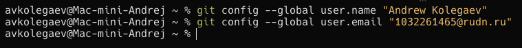{#fig-1 width=80%}

Далее настраиваю параметры utf-8, имя начальной ветки, autocrlf и safecrlf
(@fig-2).

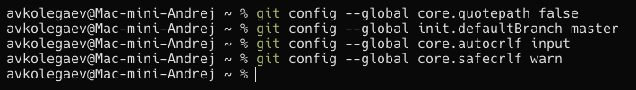{#fig-2 width=80%}

Далее создаю пару ssh ключей для интеграции с платформой GitHub
(@fig-3).

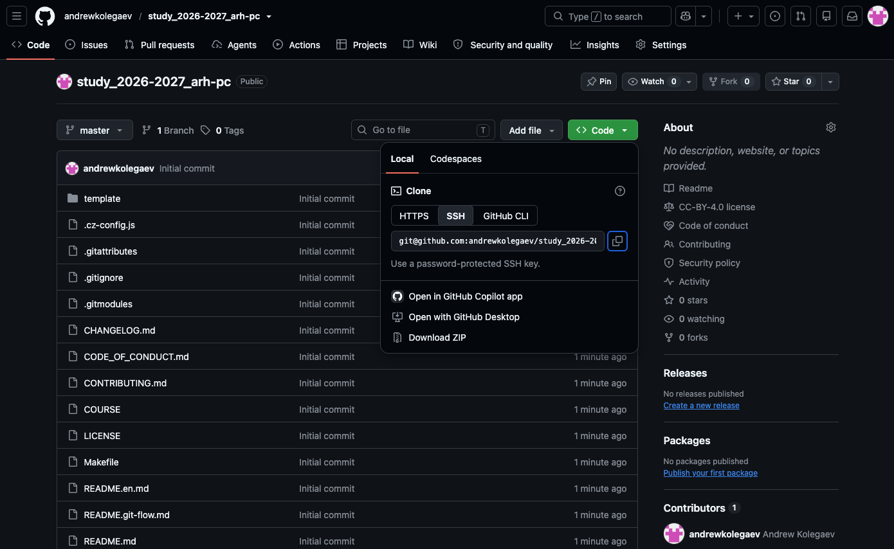{#fig-3 width=80%}

Далее я перехожу на сайт GitHub, авторизируюсь, перехожу в настройки
аккаунта, вставляю публичный ключ в предназначенное для этого поле (@fig-4).

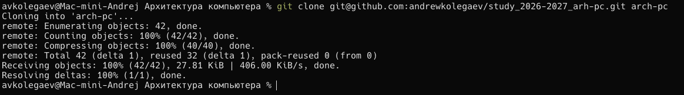{#fig-4 width=80%}

## Создание рабочего пространства и репозитория курса на основе шаблона

Я создаю директорию для определенной структурной иерархии (@fig-5).

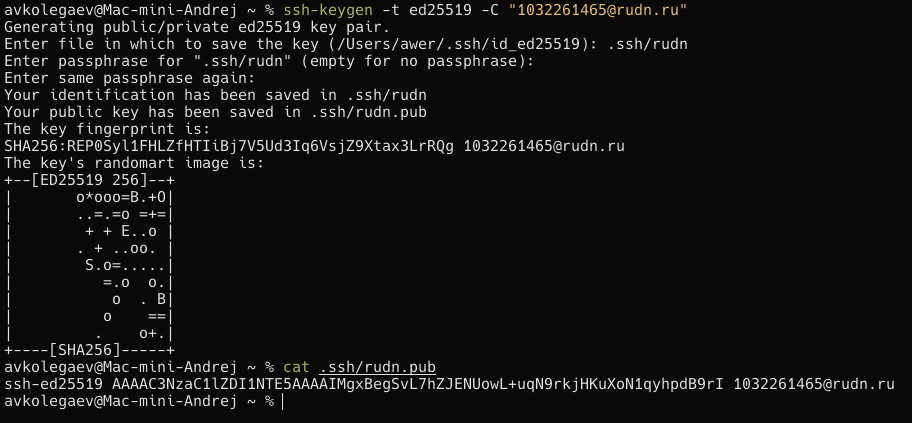{#fig-5 width=80%}

## Создание репозитория курса на основе имеющегося шаблона

Создаю репозиторий на основе имеющегося шаблона (@fig-6) через
функционал колинирования интерфейса GitHub (@fig-7).

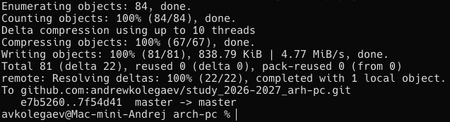{#fig-6 width=80%}

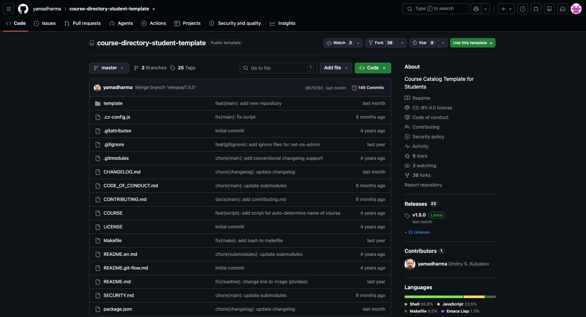{#fig-7 width=80%}

Сгенерированный репозиторий на основе шаблона клонирую на свой
рабочий компьютер, для этого беру ссылку для клонирования через интерфейс
GitHub (@fig-8) и затем ввожу в терминале git clone (@fig-9).

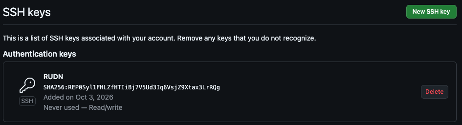{#fig-8 width=80%}

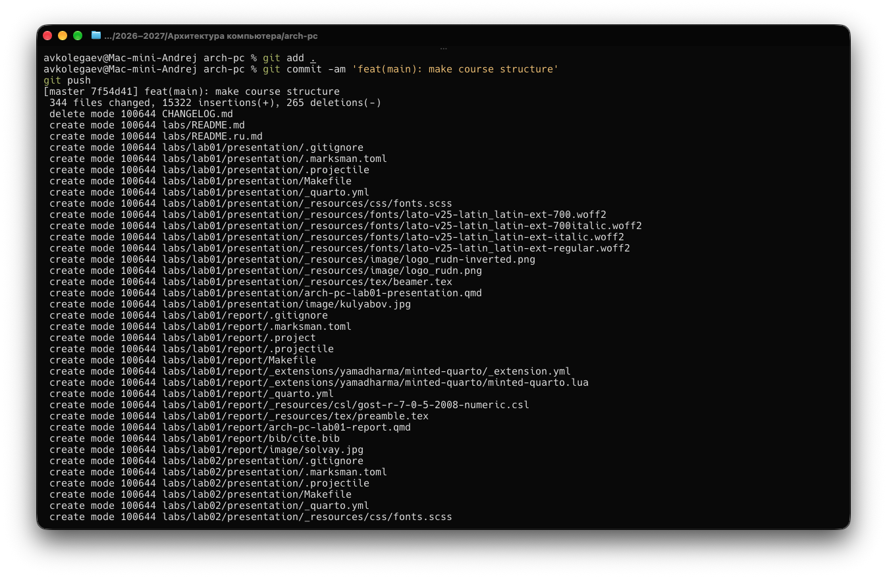{#fig-9 width=80%}

## Настройка каталога курса

В каталоге курса удаляю лишние файлы и формирую необходимые каталоги
(@fig-10).

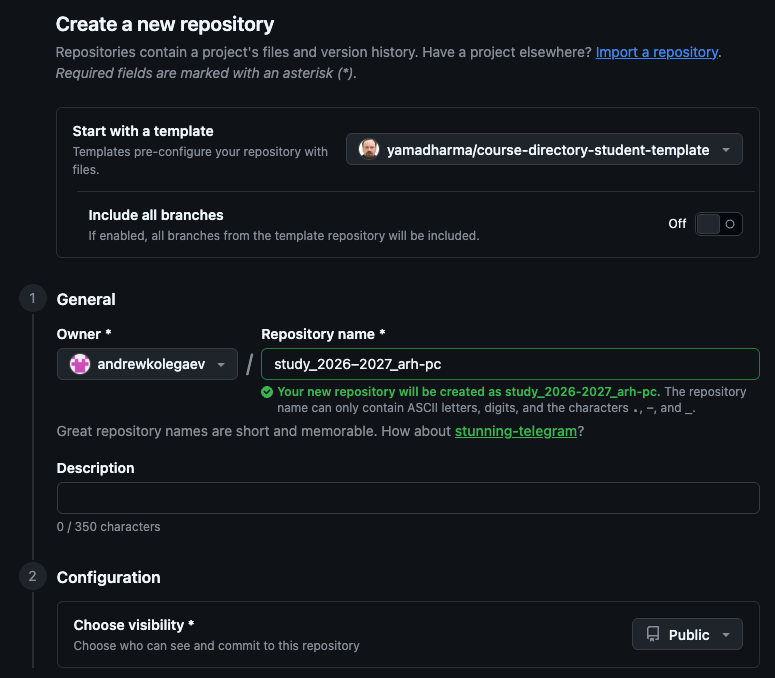{#fig-10 width=80%}

Делаю снимок сделанных изменений и загружаю их на свой репозиторий в
GitHub (@fig-11, @fig-12).

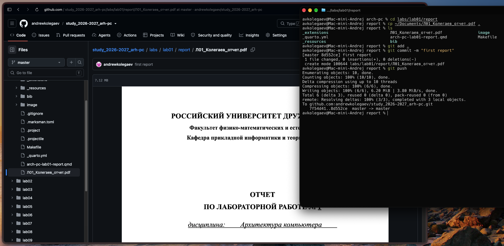{#fig-11 width=80%}

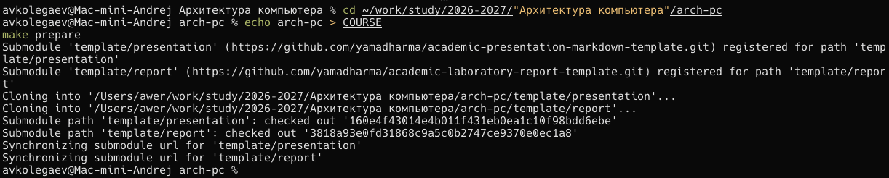{#fig-12 width=80%}

# Задания для самостоятельной работы

Через терминал отправляю предыдущий отчет по лабораторный работе на
свой удаленный репозиторий в GitHub (@fig-13).

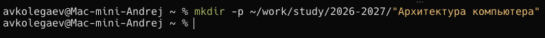{#fig-13 width=80%}

# Выводы

При выполнении данной лабораторной работы я изучил идеологию и
применение средств контроля версий, а также приобрел практические навыки по
работе с реализацией VCS — Git.

# Список литературы {.unnumbered}

1. A3.3 Приложение C: Команды Git - Основные команды. — URL: [https://git-scm.com/book/ru/v2/Приложение-C:-Команды-Git-Основные-команды](https://git-scm.com/book/ru/v2/Приложение-C:-Команды-Git-Основные-команды) (дата обращения: 17.10.2026). — Текст: электронный.
2. Работа с Git через консоль. — URL: [https://htmlacademy.ru/blog/git/git-console](https://htmlacademy.ru/blog/git/git-console) (дата обращения: 17.10.2026). — Текст: электронный.
3. Создание репозитория. — URL: [https://docs.github.com/ru/repositories/creating-and-managing-repositories/creating-a-new-repository](https://docs.github.com/ru/repositories/creating-and-managing-repositories/creating-a-new-repository) (дата обращения: 03.10.2026). — Текст: электронный.