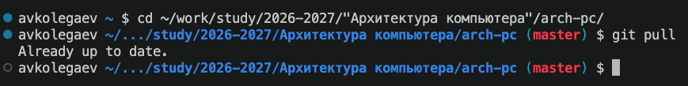
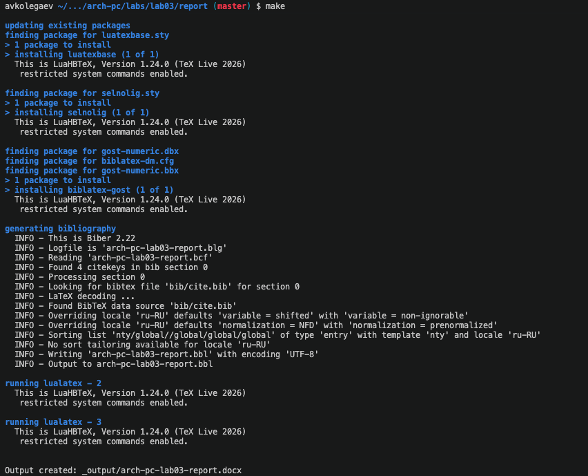
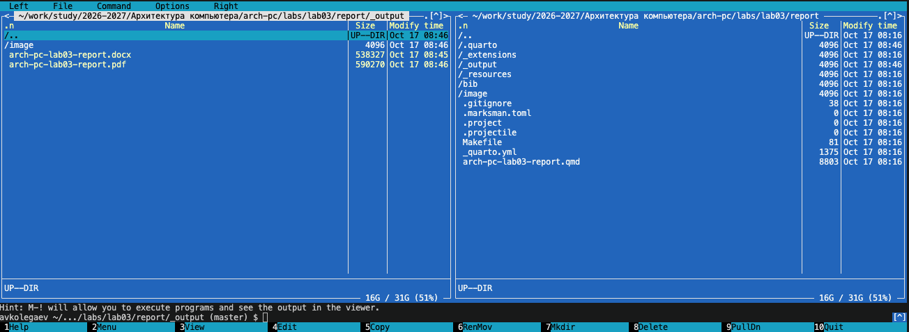
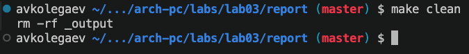
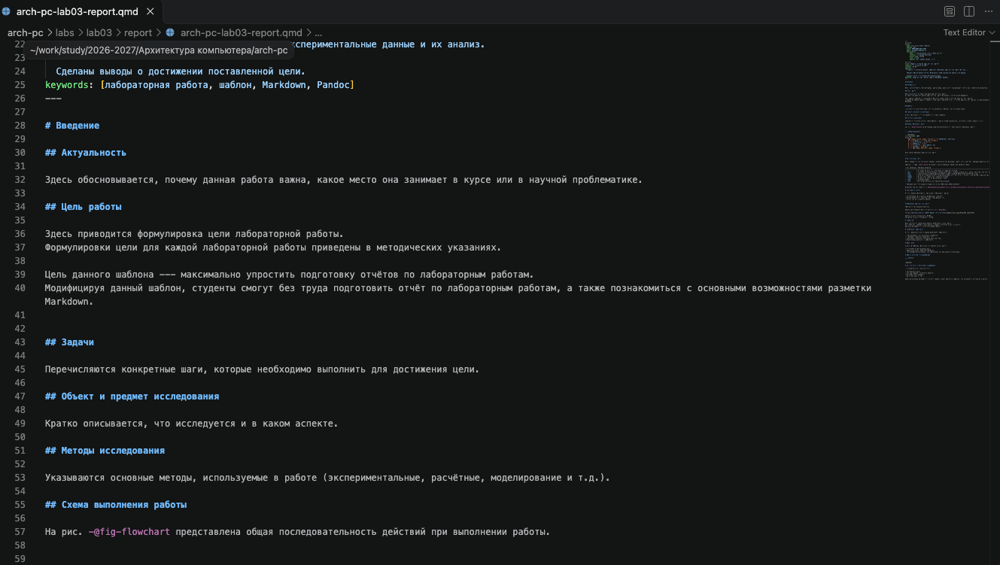
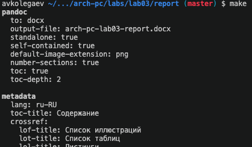
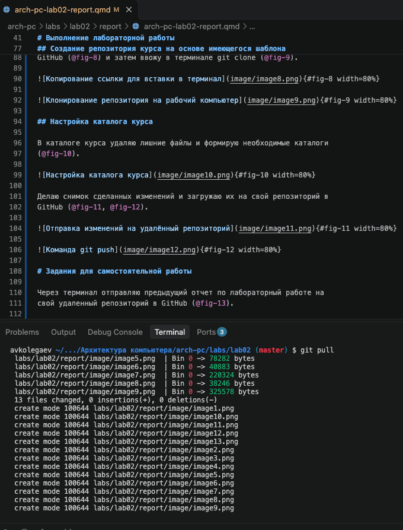

---
## Author
author:
  name: Андрей Владимирович Колегаев
  group: НФИбд-02-26
  email: 1032261465@rudn.ru
  affiliation:
    - name: Российский университет дружбы народов
      country: Российская Федерация
      postal-code: 117198
      city: Москва
      address: ул. Миклухо-Маклая, д. 6

## Title
title: "Отчёт по лабораторной работе 3"
subtitle: "Язык разметки Markdown"
license: "CC BY"
abstract: |
  В данном отчёте представлены результаты выполнения лабораторной работы 3 по освоению процедуры оформления отчетов с помощью легковесного языка разметки Markdown.

keywords: [лабораторная работа, шаблон, Markdown, Pandoc]
---

# Цель работы

Целью работы является освоение процедуры оформления отчетов с помощью легковесного языка разметки Markdown.

# Техническое обеспечение

Лабораторная работа была выполнена на домашнем ПК под управлением
операционной системы Ubuntu 26.04.1 LTS. На компьютере установлен Quarto v1.10.19 и TeX Live 2026.

# Выполнение лабораторной работы

Открыл терминал, перешел в каталог курса, сформированный при выполнении лабораторной
работы №2 и обновил локальный репозиторий, скачав изменения из удаленного репозитория командой `git pull` (@fig-1).

{#fig-1 width=80%}

Затем перешел в каталог с шаблоном отчета по лабораторной работе №3 и провел компиляцию шаблона командой `make` (@fig-2).

{#fig-2 width=80%}

Компиляция прошла успешно, в каталоге с шаблоном отчета появились файлы arch-pc-lab03-report.docx и arch-pc-lab03-report.pdf (@fig-3).

{#fig-3 width=80%}

После этого я удалил эти файлы командой `make clean` и проверил, что они действительно удалены (@fig-4).

{#fig-4 width=80%}

Далее я открыл файл arch-pc-lab03-report.qmd в текстовом редакторе и изучил его структуру (@fig-5).

{#fig-5 width=80%}

Опираясь на шаблон отчета, я создал свой отчет по лабораторной работе №3, заполнив его необходимой информацией и заново сгенерировал файлы arch-pc-lab03-report.docx и arch-pc-lab03-report.pdf уже со своим содержимым (@fig-6).

{#fig-6 width=80%}

После этого я загрузил файлы отчета в свой удаленный репозиторий на GitHub при помощи команд `git add`, `git commit` и `git push`.

# Задания для самостоятельной работы

В каталоге `labs/lab02/report` я создал отчет по лабораторной работе №2 в трех форматах: .pdf, .docx и .qmd. Загрузил эти файлы на GitHub (@fig-7).

{#fig-7 width=80%}

# Выводы

При выполнении данной лабораторной работы я освоил процедуру оформления отчетов с помощью легковесного языка разметки Markdown.