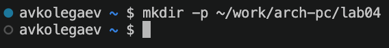
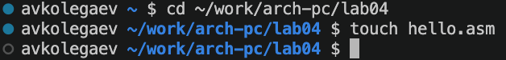
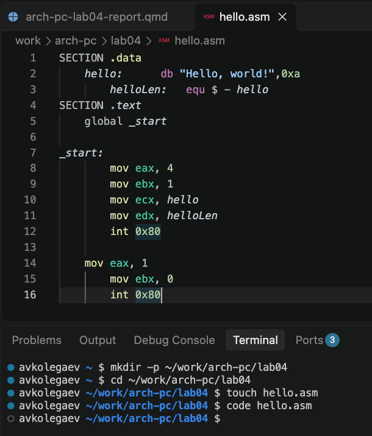
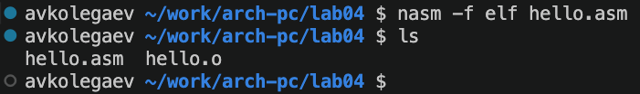
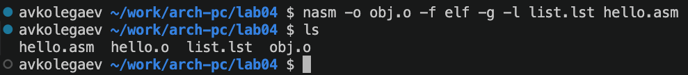
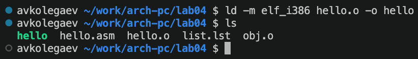
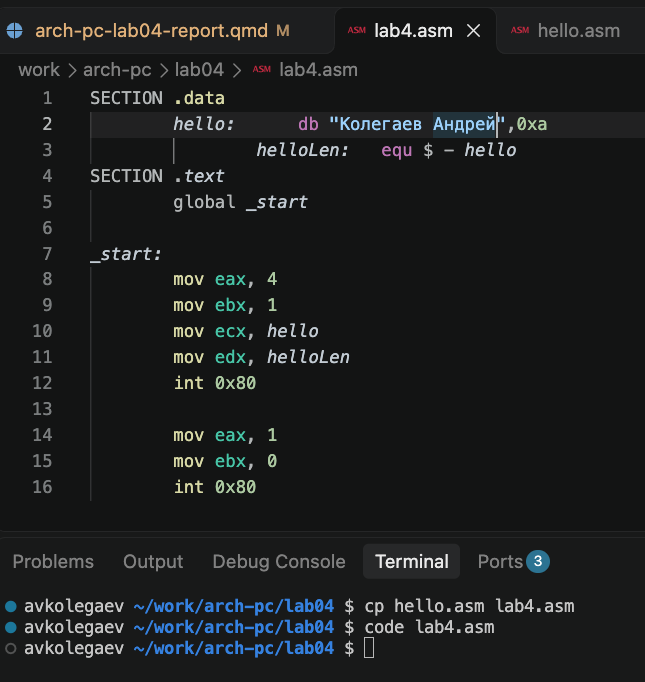
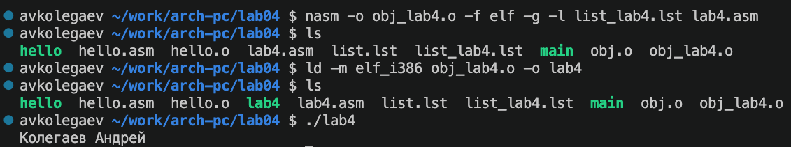
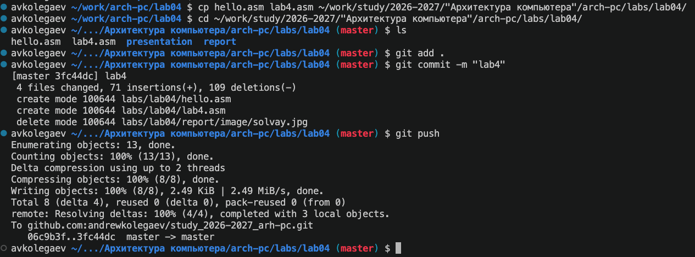

---
## Author
author:
  name: Андрей Владимирович Колегаев
  group: НФИбд-02-26
  email: 1032261465@rudn.ru
  affiliation:
    - name: Российский университет дружбы народов
      country: Российская Федерация
      postal-code: 117198
      city: Москва
      address: ул. Миклухо-Маклая, д. 6

## Title
title: "Отчёт по лабораторной работе №4"
subtitle: "Создание и процесс обработки программ на языке ассемблера NASM"
license: "CC BY"
abstract: |
  В данном отчёте представлены результаты выполнения лабораторной работы 4 по освоению процедуры компиляции и сборки программ, написанных на ассемблере NASM.

keywords: [лабораторная работа, шаблон, Markdown, Pandoc]
---

# Цель работы

Целью работы является освоение процедуры компиляции и сборки программ, написанных на ассемблере NASM.

# Выполнение лабораторной работы

## Программа Hello world!

Создаю каталог для работы с программами на языке ассемблера NASM (@fig-1).

{#fig-1 width=80%}

Перехожу в созданный каталог и создаю текстовый файл с именем `hello.asm` (@fig-2).

{#fig-2 width=80%}

Редактирую файл `hello.asm` в текстовом редакторе, добавляя в него код программы Hello world! (@fig-3).

{#fig-3 width=80%}

## Транслятор NASM

Компилирую программу Hello world! с помощью транслятора NASM командой `nasm -f elf hello.asm` и получаю файл `hello.o` (@fig-4).

{#fig-4 width=80%}

## Расширенный синтаксис командной строки NASM

Компилирую файл `hello.asm` с помощью транслятора NASM, используя расширенный синтаксис командной строки NASM и получаю объектный файл `hello.o` и файл листинга `list.lst` (@fig-5).

{#fig-5 width=80%}

## Компоновщик LD

Затем передаю исходный файл на обработку компановщику и проверяю, что исполняемый файл `hello` был успешно создан (@fig-6).

{#fig-6 width=80%}

Выполняю команду `ld -m elf_i386 obj.o -o main` и получаю объектный файл `obj.o` и исполняемый файл `main` (@fig-7).

## Запуск исполняемого файла

Находясь в каталоге с исполняемым файлом `hello`, запускаю его командой `./hello` и получаю сообщение "Hello, world!" (@fig-8).

## Задание для самостоятельной работы

В каталоге `~/work/arch-pc/lab04` с помощью команды `cp` создаю копию файла `hello.asm` с именем `lab4.asm` (@fig-9).

{#fig-9 width=80%}

С помощью текстового редактора вношу изменения в файл `lab4.asm` так, чтобы вместо сообщения "Hello, world!" выводились мои фамилия и имя (@fig-10).

{#fig-10 width=80%}

Далее транслирую полученную программу в объектный файл `lab4.o`, выполняю компоновку и запускаю получившийся исполняемый файл `lab4` (@fig-11).

{#fig-11 width=80%}

Копирую файлы `hello.asm` и `lab4.asm` в каталог `~/work/study/2026-2027/Архитектура компьютера/arch-pc/labs/lab04/`, после чего загружаю их в удалённый репозиторий (@fig-12).

{#fig-12 width=80%}

# Выводы

При выполнении данной лабораторной работы я освоил процедуру компиляции и сборки программ, написанных на ассемблере NASM.