---
## Author
author:
  name: Андрей Владимирович Колегаев
  group: НФИбд-02-26
  email: 1032261465@rudn.ru
  affiliation:
    - name: Российский университет дружбы народов
      country: Российская Федерация
      postal-code: 117198
      city: Москва
      address: ул. Миклухо-Маклая, д. 6

## Title
title: "Отчёт по лабораторной работе №5"
subtitle: "Структура программы на языке ассемблера NASM"
license: "CC BY"
abstract: |
  В данном отчёте представлены результаты выполнения лабораторной работы 5 по освоению структуры программ на языке ассемблера NASM.

keywords: [лабораторная работа, шаблон, Markdown, Pandoc]
---

# Цель работы

Целью работы является приобретение практических навыков работы в Midnight Commander. Освоение инструкций языка ассемблера mov и int.

# Выполнение лабораторной работы

Открываю Midnight Commander (@fig-1).

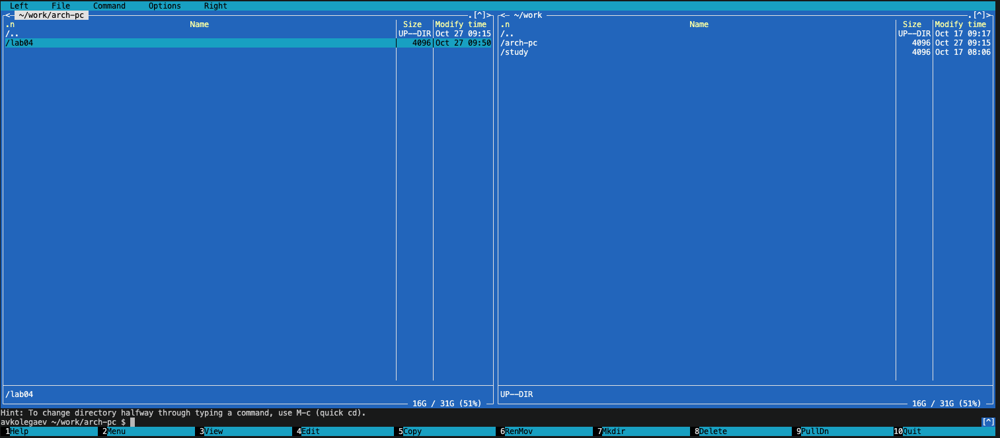{#fig-1 width=80%}

Перехожу в каталог `~work/arch-pc` и создаю в нём папку `lab05` (@fig-2).

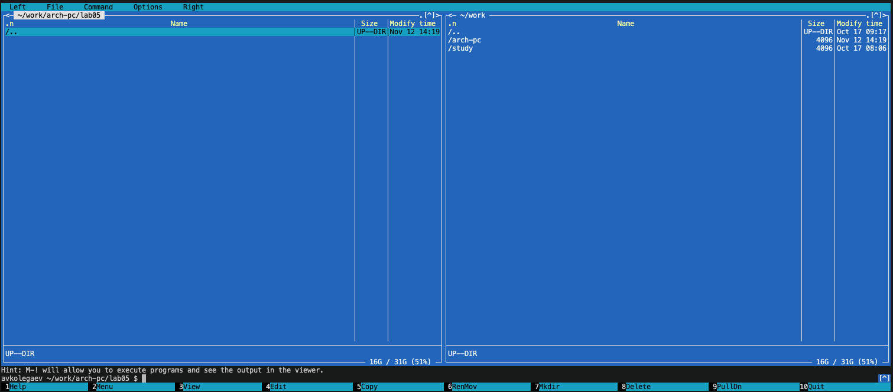{#fig-2 width=80%}

В папке `lab05` создаю файл `lab5-1.asm` и открываю его в редакторе Midnight Commander (@fig-3).

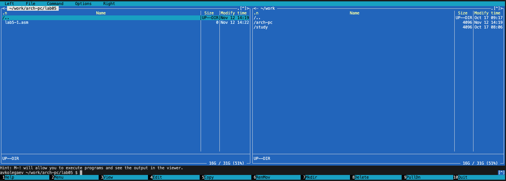{#fig-3 width=80%}

Добавляю в файл `lab5-1.asm` код программы (@fig-4):

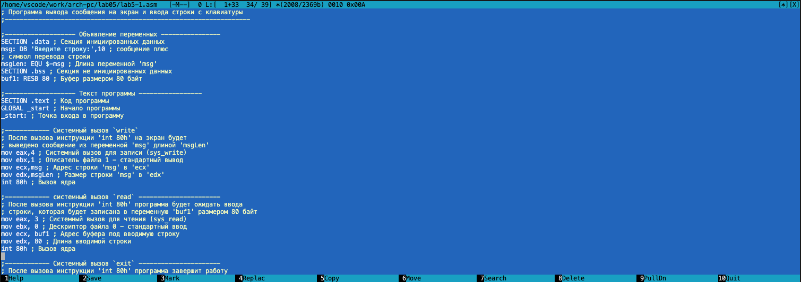{#fig-4 width=80%}

С помощью клавиши `F3` открываю файл и проверяю его содержимое (@fig-5).

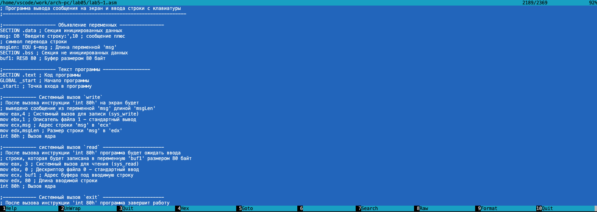{#fig-5 width=80%}

Далее транслирую программу в объектный файл, выполняю его компоновку и запускаю получившийся исполняемый файл (@fig-6).

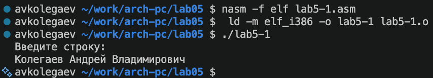{#fig-6 width=80%}

## Подключение внешнего файла in_out.asm

Скачиваю файл `in_out.asm` из ТУИС и помещаю его в папку `lab05` (@fig-7).

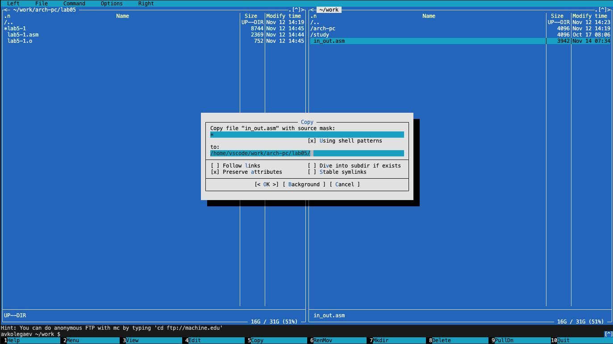{#fig-7 width=80%}

Создаю копию файла `lab5-1.asm` с именем `lab5-2.asm` и открываю её в редакторе Midnight Commander (@fig-8).

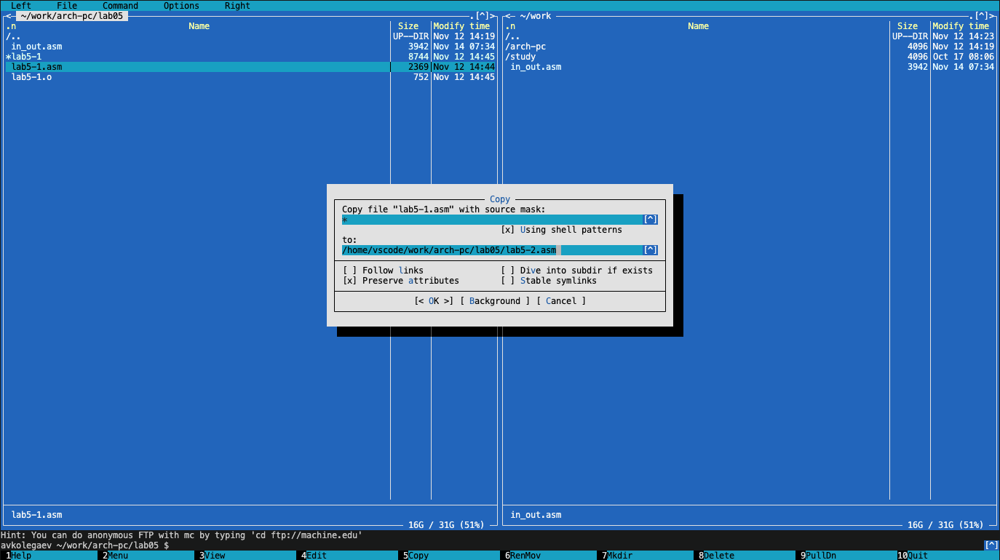{#fig-8 width=80%}

Редактирую файл `lab5-2.asm` с использованием функций из файла `in_out.asm` (@fig-9).

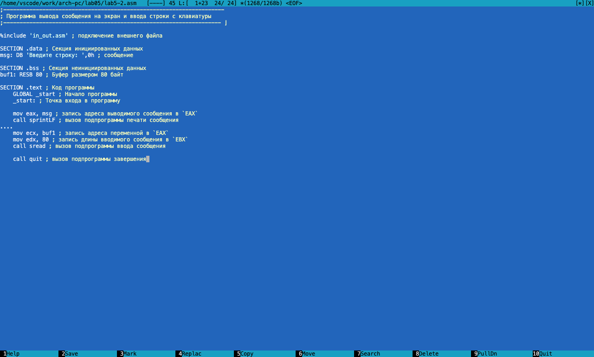{#fig-9 width=80%}

Создаю исполняемый файл и запускаю его (@fig-10).

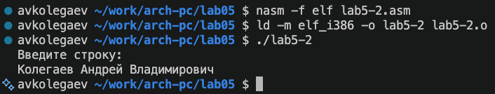{#fig-10 width=80%}

Заменяю вызов функции `sprintLF` на `sprint` в файле `lab5-2.asm` (@fig-11) и снова создаю исполняемый файл (@fig-12).

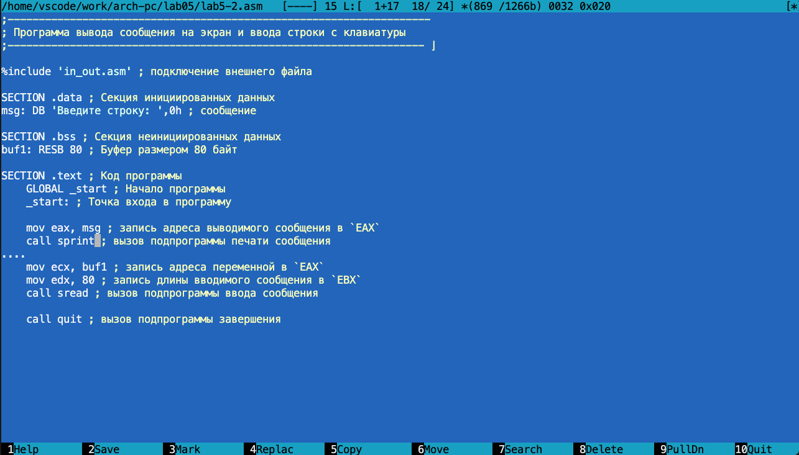{#fig-11 width=80%}

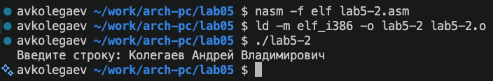{#fig-12 width=80%}

Разница между подпрограммами `sprintLF` и `sprint` заключается в том, что первая добавляет переход на новую строку в конце вывода, а вторая — не добавляет.

# Задание для самостоятельной работы

Создаю копию файла `lab5-1.asm` с именем `lab-5-3.asm` (@fig-13) и открываю её в редакторе Midnight Commander (@fig-14).

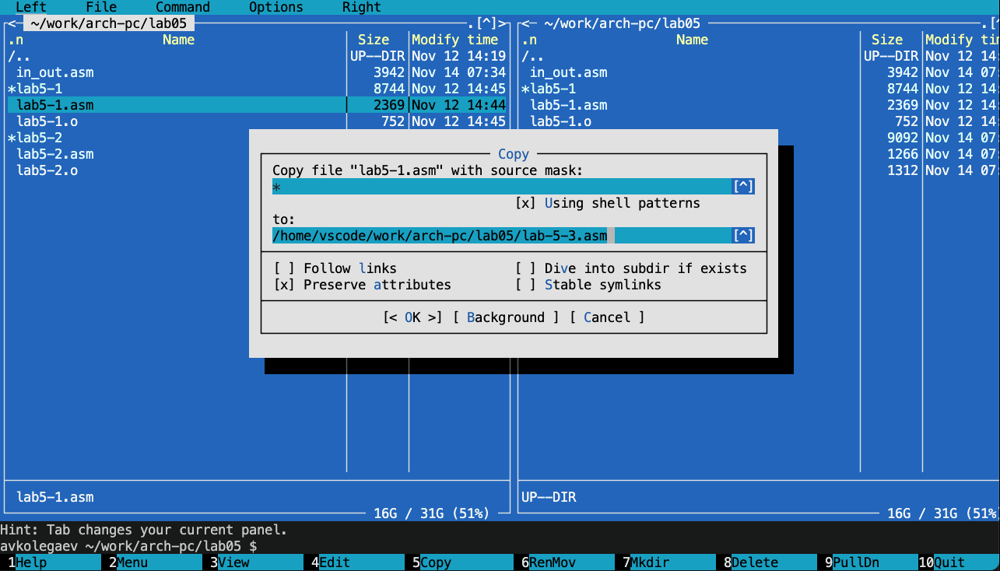{#fig-13 width=80%}

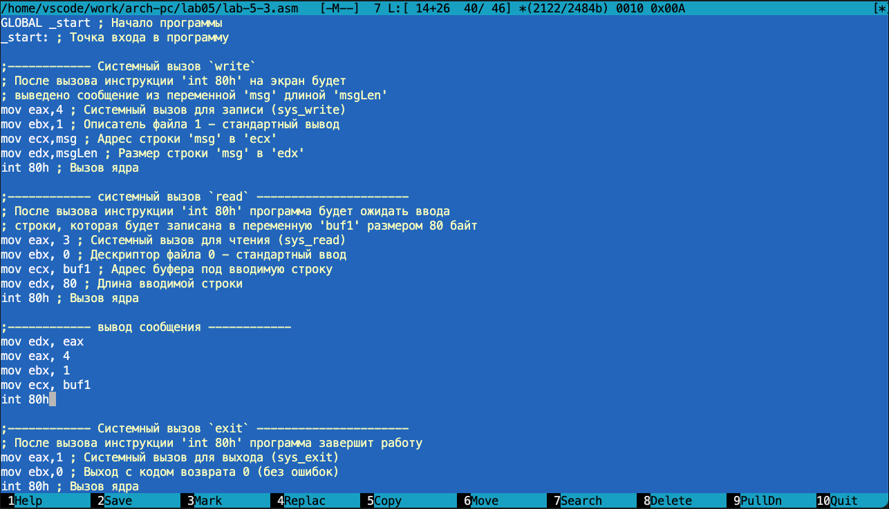{#fig-14 width=80%}

Для вывода сообщения я использовал следующий код:
```
mov edx, eax
mov eax, 4
mov ebx, 1
mov ecx, buf1
int 80h
```

Объяснение кода:

- `mov edx, eax` — копирует значение из регистра `eax` в регистр `edx`, который используется для указания длины сообщения.

- `mov eax, 4` — системный вызов для записи (`sys_write`).

- `mov ebx, 1` — стандартный вывод (`stdout`).

- `mov ecx, buf1` — устанавливает адрес буфера `buf1`, который содержит сообщение для вывода.

- `int 80h` — вызов ядра.

Создаю исполняемый файл и проверяю его работу (@fig-15).

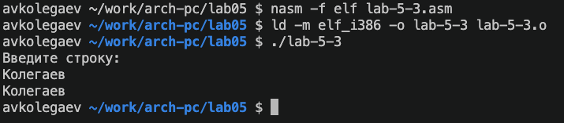{#fig-15 width=80%}

Создаю копию файла `lab5-2.asm` с именем `lab5-4.asm` (@fig-16).

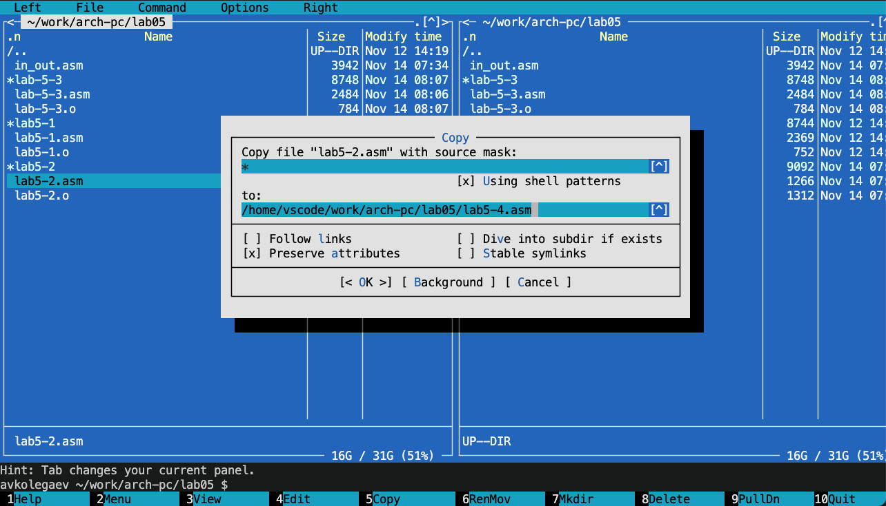{#fig-16 width=80%}

Добавляю вызов функции `sprint` для вывода сообщения `lab5-4.asm` (@fig-17).

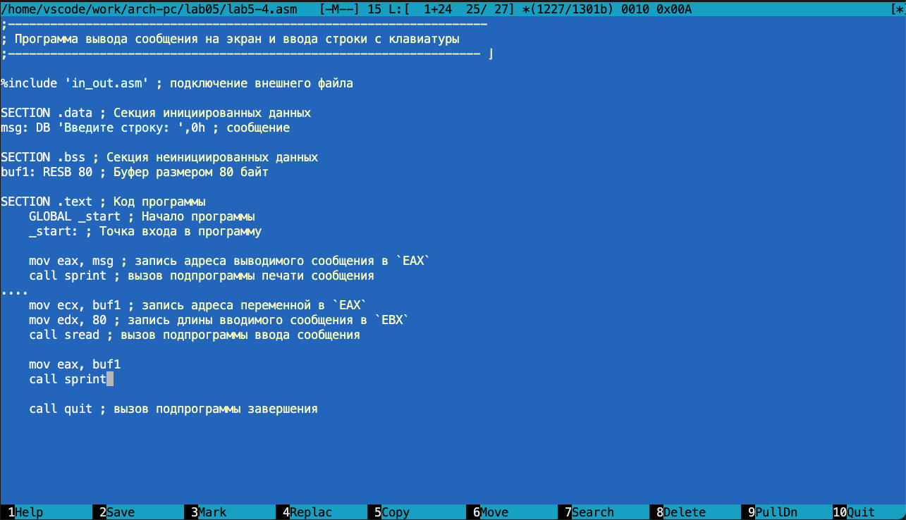{#fig-17 width=80%}

Создаю исполняемый файл `lab5-4` и проверяю его работу (@fig-18).

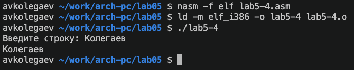{#fig-18 width=80%}

# Выводы

При выполнении данной лабораторной работы я приобрел практические навыки работы в Midnight Commander и освоил инструкции языка ассемблера mov и int.