---
## Author
author:
  name: Андрей Владимирович Колегаев
  group: НФИбд-02-26
  email: 1032261465@rudn.ru
  affiliation:
    - name: Российский университет дружбы народов
      country: Российская Федерация
      postal-code: 117198
      city: Москва
      address: ул. Миклухо-Маклая, д. 6

## Title
title: "Отчёт по лабораторной работе №6"
subtitle: "Арифметические операции в NASM"
license: "CC BY"
abstract: |
  В данном отчёте представлены результаты выполнения лабораторной работы 6 по освоению арифметических инструкций языка ассемблера NASM.

keywords: [лабораторная работа, шаблон, Markdown, Pandoc]
---

# Цель работы

Целью работы является освоение арифметических инструкций языка ассемблера NASM.

# Выполнение лабораторной работы

## Символьные и численные данные в NASM

Создаю каталог `~/work/arch-pc/lab06` и создаю в нём файл `lab6-1.asm` (@fig-1).

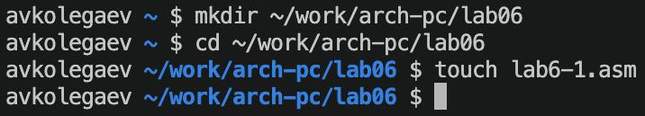{#fig-1 width=80%}

Ввожу в файл текст программы. Ожидается, что в выводе программы будет число 10 (@fig-2).

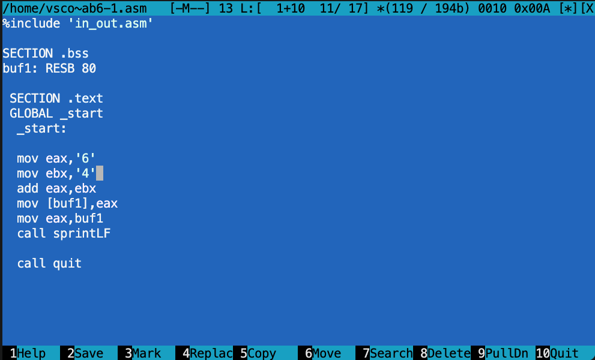{#fig-2 width=80%}

Копирую файл `in_out.asm` в текующий каталог из предыдущей лабораторной работы (@fig-3).

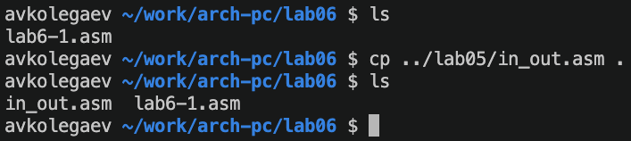{#fig-3 width=80%}

Компилирую и запускаю программу. (@fig-4).

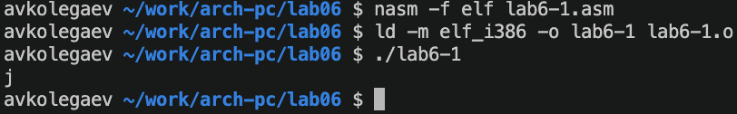{#fig-4 width=80%}

Однако в выводе программы получаю не число 10, а символ `j`, так как коду символа 6 соответствует число 54 в десятичной системе счисления, а коду символа 4 соответствует число 52 в десятичной системе счисления. В результате сложения этих чисел получается число 106, которое соответствует символу `j`.

Заменяю в коде программы символы `6` и `4` на числа 6 и 4 (@fig-5).

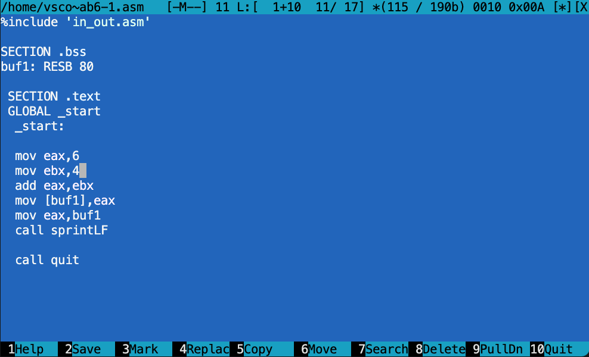{#fig-5 width=80%}

Снова создаю исполняемый файл и запускаю его (@fig-6).

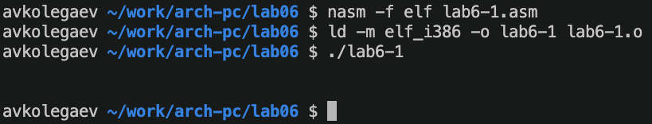{#fig-6 width=80%}

На этот раз в выводе программы получаю символ переноса строки, так как именно он соответствует коду 10 (@ascii_website_ascii-table_en).

Создаю файл `lab6-2.asm` (@fig-7) и ввожу в него текст программы для вывода значения регистра eax (@fig-8).

{#fig-7 width=80%}

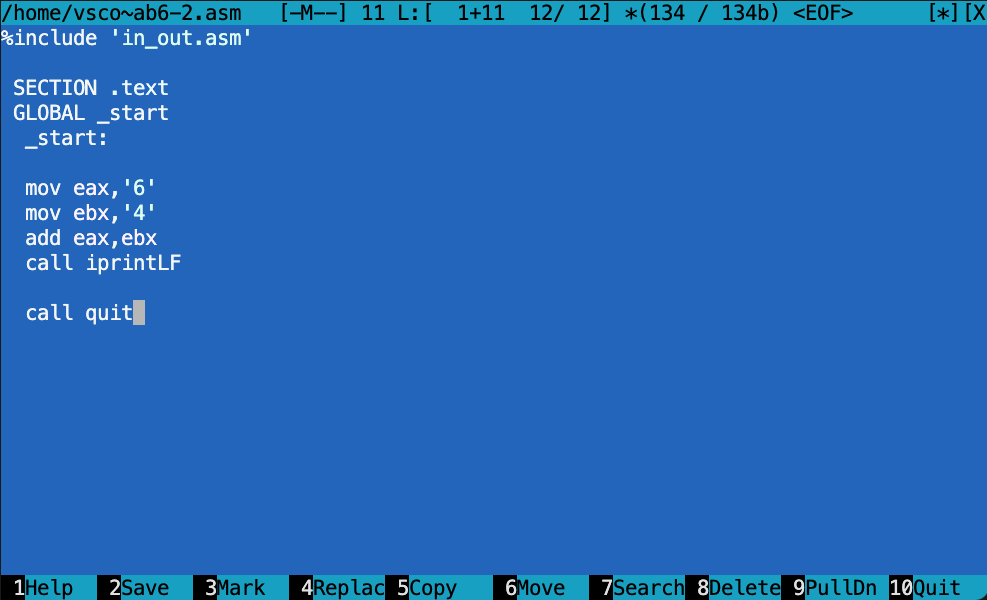{#fig-8 width=80%}

Создаю исполняемый файл и запускаю его (@fig-9).

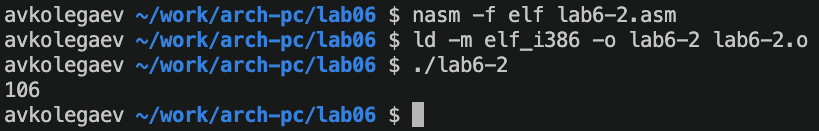{#fig-9 width=80%}

Получаю в выводе программы число 106. Команда `add` так же складывает коды 54 и 52, которые соответствуют символам `6` и `4`, и в результате получается число 106. В отличие от прошлой программы здесь выводится не символ, соответсвующий коду, а сам код.

Заменяю символы `6` и `4` на числа 6 и 4 (@fig-10).

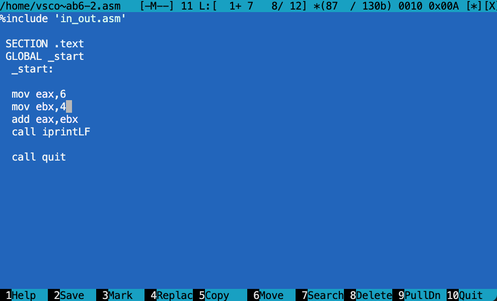{#fig-10 width=80%}

Запускаю программу и получаю в выводе число 10 (@fig-11).

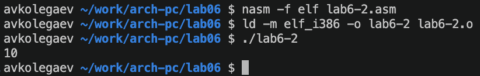{#fig-11 width=80%}

Заменяю функцию `iprintLF` на функцию `iprint` (@fig-12).

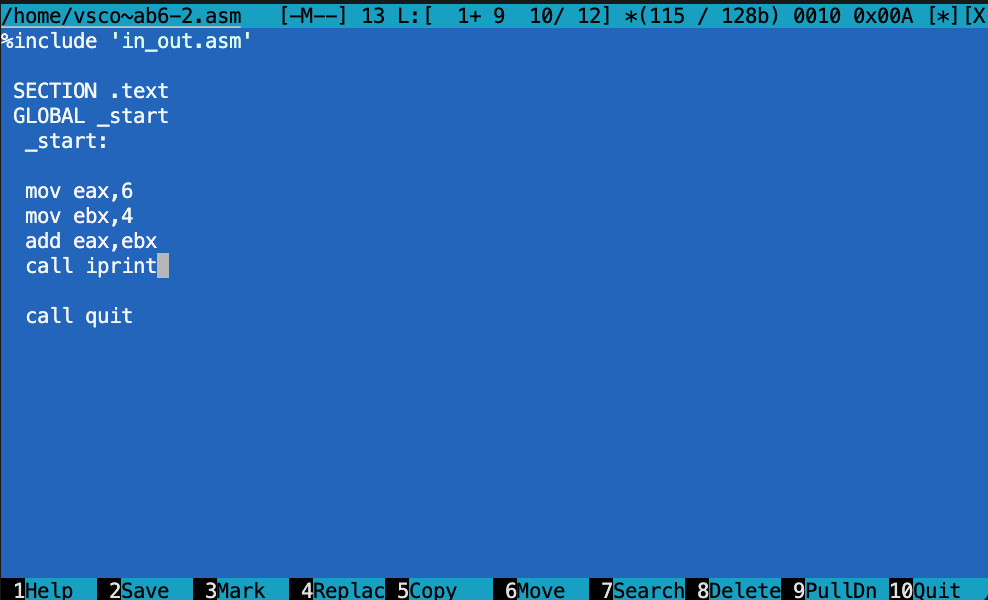{#fig-12 width=80%}

Компилирую и запускаю программу. В выводе программы получаю число 10 без символа переноса строки (@fig-13).

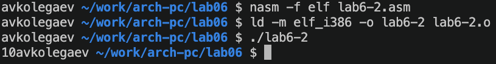{#fig-13 width=80%}

## Выполнение арифметических операций в NASM

Создаю файл `lab6-3.asm` и ввожу в него текст программы для вычисления арифметического выражения $f(x) = (5 * 2 + 3) / 3$ (@fig-14).

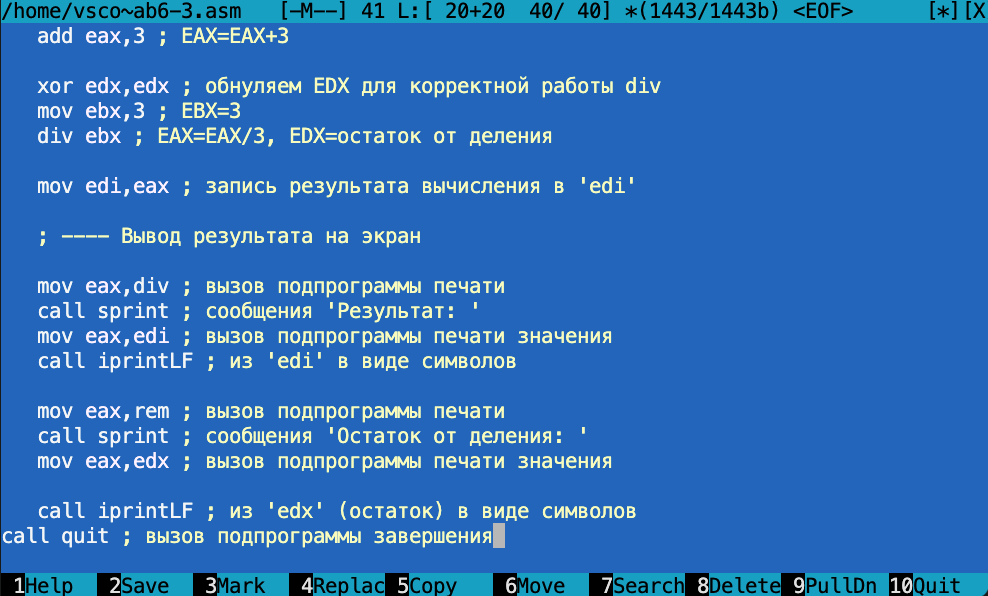{#fig-14 width=80%}

Компилирую и запускаю программу. В выводе программы получаю число 4 и остаток 1 (@fig-15).

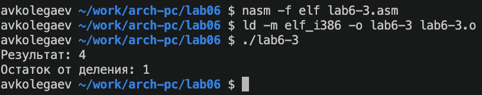{#fig-15 width=80%}

Изменяю текст программы для вычисления арифметического выражения $f(x) = (4 * 6 + 2) / 5$ (@fig-16).

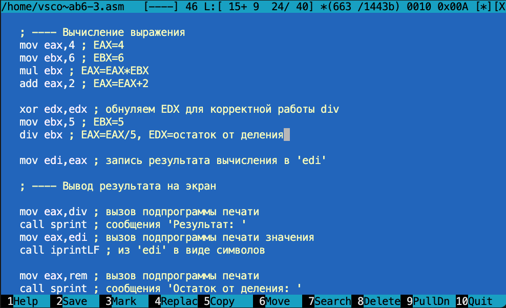{#fig-16 width=80%}

Запускаю программу и получаю в выводе число 5 и остаток 1 (@fig-17).

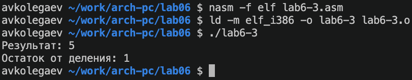{#fig-17 width=80%}

Теперь создаю файл `variant.asm` (@fig-18) и ввожу в него текст программы для вычисления варианта задания по номеру студенческого билета (@fig-19).

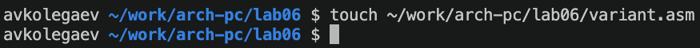{#fig-18 width=80%}

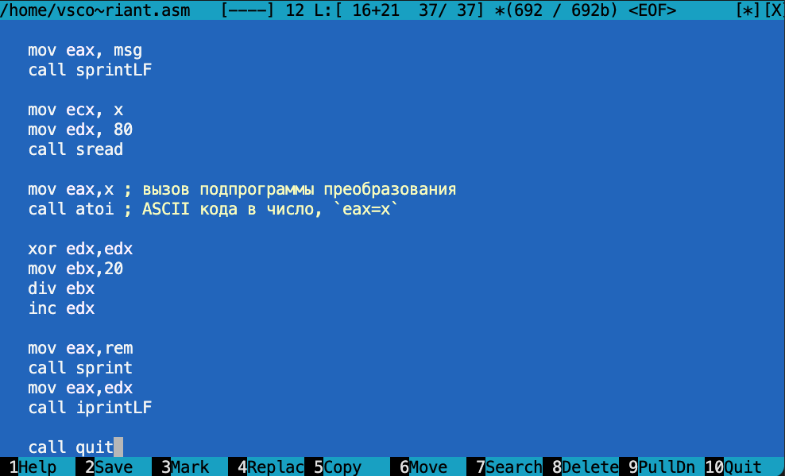{#fig-19 width=80%}

Запускаю программу и получаю номер варианта по своему студенческому билету (@fig-20).

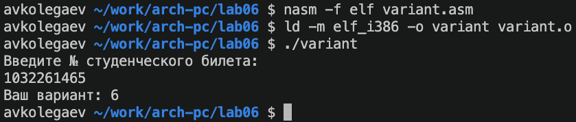{#fig-20 width=80%}

Для проверки вычисляю номер варианта вручную:

- остаток от деления 1032261465 на 20 равен 5

- прибавляю 1, получаю номер варианта 6, что совпадает с результатом работы программы.

## Ответы на вопросы

1. Какие строки листинга 6.4 отвечают за вывод на экран сообщения „Ваш вариант:“?

За вывод сообщения отвечают следующие строки:

```nasm
mov eax, msg
call sprintLF
```

Команда из первой строчки копирует адрес первого символа сообщения, далее команда из второй строчки выводит сообщение на экран.


2. Для чего используются следующие инструкции?

```nasm
mov ecx, x
mov edx, 80
call sread
```

Эти инструкции используются для чтения строки с клавиатуры.

Команда `mov ecx, x` копирует в регистр `ecx` адрес буфера `x`, куда будет записана строка.

Команда `mov edx, 80` ограничивает длину строки 80 байтами.

Команда `call sread` вызывает функцию чтения строки.


3. Для чего используется инструкция `call atoi`?

Эта инструкция вызывает функцию `atoi`, которая преобразует символ ASCII в число.


4. Какие строки листинга `6.4` отвечают за вычисления варианта?

За вычисления варианта отвечают следующие строки:

```nasm
xor edx,edx
mov ebx,20
div ebx
inc edx
```


5. В какой регистр записывается остаток от деления при выполнении инструкции `div ebx`?

Остаток от деления записывается в регистр `edx`.


6. Для чего используется инструкция `inc edx`?

Инструкция `inc edx` увеличивает значение в регистре `edx` на 1. В нашей программе она используется для увеличения остатка от деления на 1, чтобы получить номер варианта.


7. Какие строки листинга 6.4 отвечают за вывод на экран результата вычислений?

За вывод результата на экран отвечают следующие строки:

```nasm
mov eax,rem
call sprint
mov eax,edx
call iprintLF
```

# Задание для самостоятельной работы

Создаю файл `lab6-4.asm` (@fig-21) и ввожу в него текст программы для вычисления арифметического выражения $f(x) = 𝑥^3 / 2 + 1$ (@fig-22).

{#fig-21 width=80%}

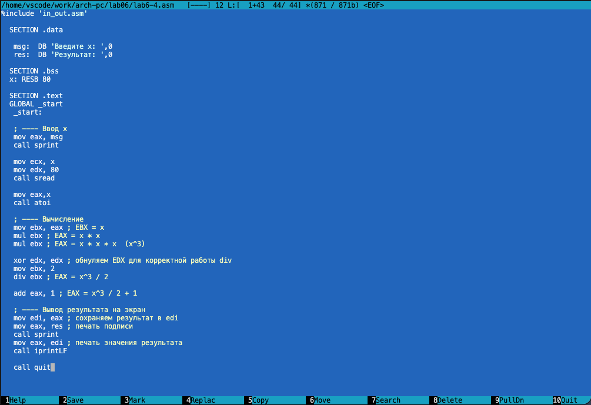{#fig-22 width=80%}

Создаю исполняемый файл и проверяю результат программы для значений $x_1$ и $x_2$ (@fig-23).

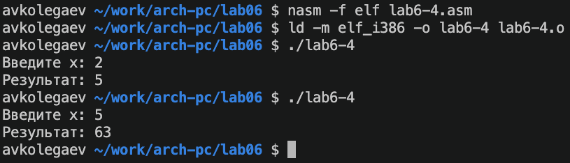{#fig-23 width=80%}

Для $x_1 = 2$ получаю результат $f(x_1) = 5$, а для $x_2 = 5$ получаю результат $f(x_2) = 63$, что совпадает с результатами ручного вычисления (во втором случае дробная часть отбрасывается).

# Выводы

При выполнении данной лабораторной работы я освоил основы работы с арифметическими инструкциями языка ассемблера NASM.

# Список литературы {.unnumbered}

::: {#refs}
:::