---
## Author
author:
  name: Андрей Владимирович Колегаев
  group: НФИбд-02-26
  email: 1032261465@rudn.ru
  affiliation:
    - name: Российский университет дружбы народов
      country: Российская Федерация
      postal-code: 117198
      city: Москва
      address: ул. Миклухо-Маклая, д. 6

## Title
title: "Отчёт по лабораторной работе №7"
subtitle: "Команды безусловного и условного переходов в Nasm. Программирование ветвлений"
license: "CC BY"
abstract: |
  В данном отчёте представлены результаты выполнения лабораторной работы 7 по изучению команд условного и безусловного переходов, приобретению навыков написания программ с использованием переходов и знакомству с назначением и структурой файла листинга.

keywords: [лабораторная работа, шаблон, Markdown, Pandoc]
---

# Цель работы

Целью работы является изучение команд условного и безусловного переходов, приобретение навыков написания программ с использованием переходов и знакомство с назначением и структурой файла листинга.

# Выполнение лабораторной работы

## Реализация переходов в NASM

Создаю каталог `~/work/arch-pc/lab07` и создаю в нём файл `lab7-1.asm` (@fig-1).

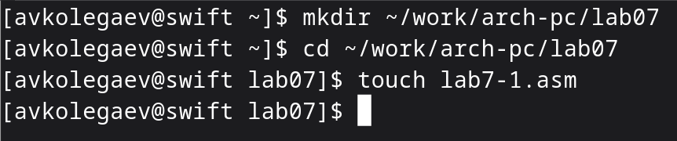{#fig-1 width=80%}

Ввожу в файл текст программы с использованием инструкции jmp (@fig-2).

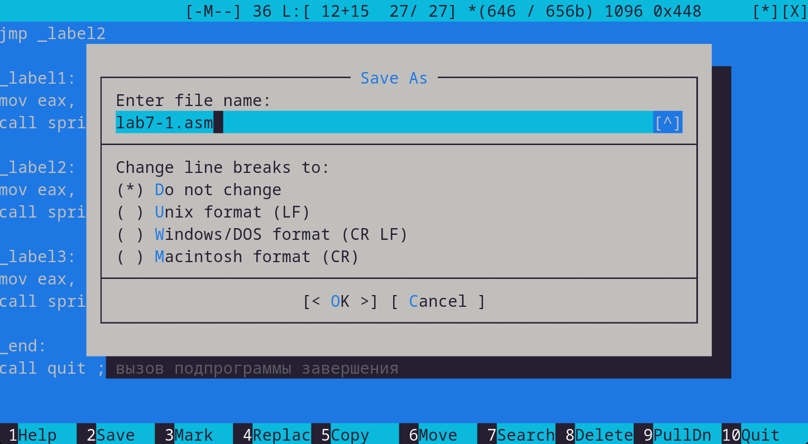{#fig-2 width=80%}

Не забываю скопировать файл `in_out.asm` в текующий каталог и запускаю программу (@fig-3).

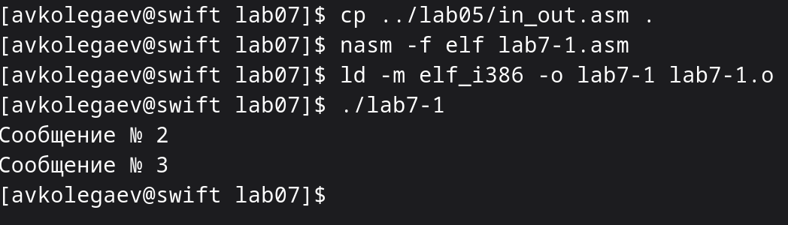{#fig-3 width=80%}

Теперь изменяю программу так, чтобы она выводила сначала «Сообщение №2», а потом «Сообщение №1» (@fig-4).

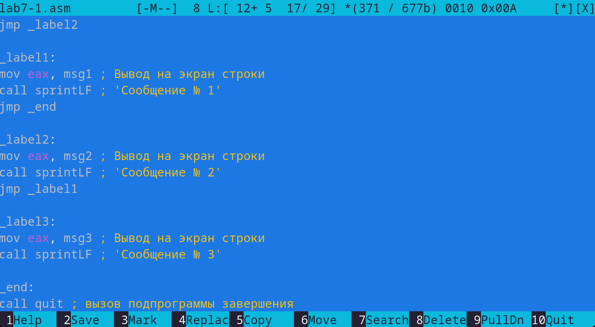{#fig-4 width=80%}

Компилирую и запускаю её (@fig-5).

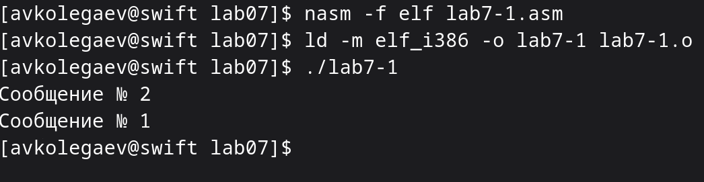{#fig-5 width=80%}

Изменяю программу таким образом, чтобы получить следующий вывод:

```
Сообщение № 3
Сообщение № 2
Сообщение № 1
```

(@fig-6).

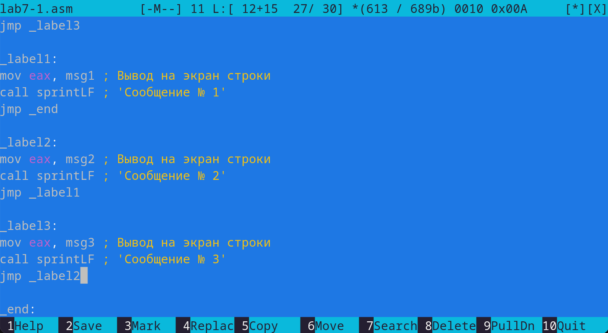{#fig-6 width=80%}

Проверяю, что всё работает верно (@fig-7).

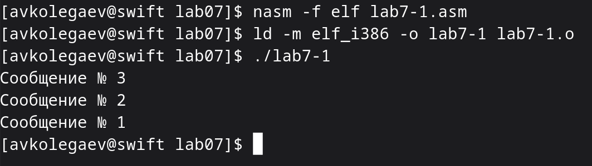{#fig-7 width=80%}

Далее создаю файл `lab7-2.asm` и ввожу в него текст программы для определения наибольшей из трёх целочисленных переменных (@fig-8).

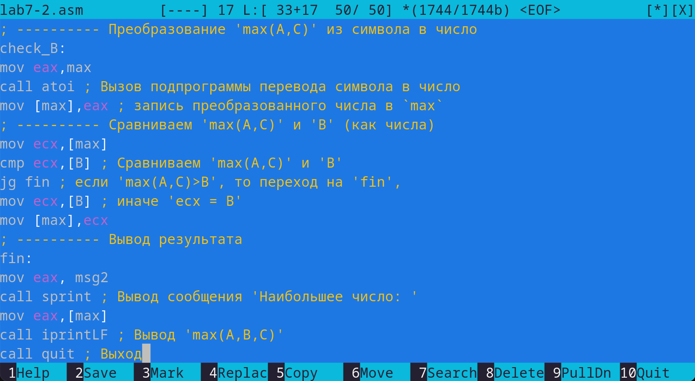{#fig-8 width=80%}

Проверяю работу программы для разных значений переменной B (@fig-9).

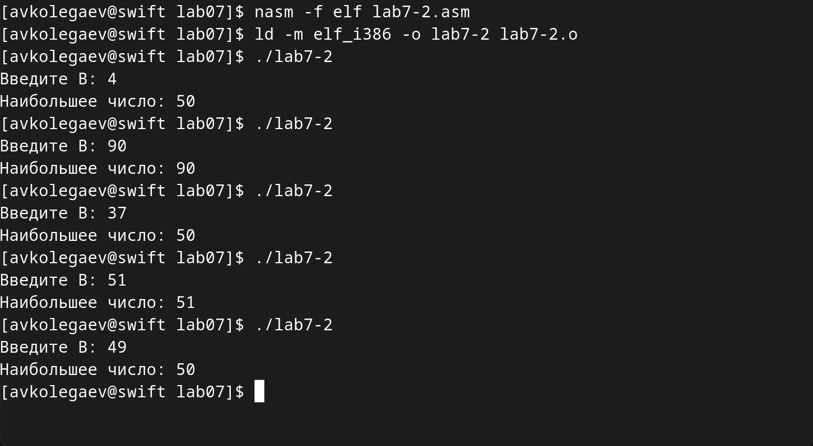{#fig-9 width=80%}

## Изучение структуры файла листинга

Создаю файл листинга программы `lab7-2` (@fig-10) и изучаю его (@fig-11).

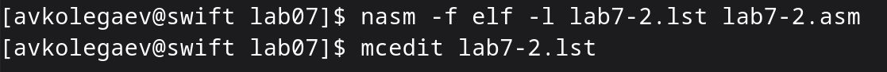{#fig-10 width=80%}

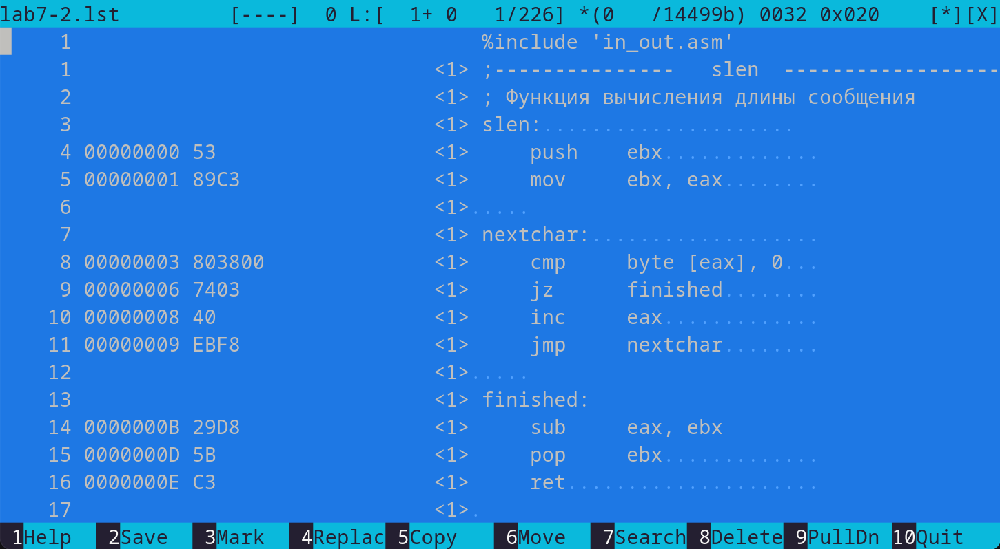{#fig-11 width=80%}

Объясню содержимое трёх разных строк из этого листинга:

1. **6 строка**: `6 00000039 35300000                C dd '50'` (@fig-12)

{#fig-12 width=80%}

- `00000039` обозначает адрес смещения в шестнадцатеричной системе от начала сегмента данных `.data`. Предыдущая переменная `A` находилась по адресу `00000035` и занимала 4 байта, соответственно следующая после неё переменная `C` начинается со смещения 35+4=39.

- `35300000`: символ `5` в ASCII-таблице имеет код `35h`, а символ `0` - код `30h`, отсюда и `3530`. Директивой dd выделяется 4 байта памяти, из которых мы заняли только 2, поэтому остальные 2 байта заполняются нулями `0000`.

- `C dd '50'` - создание метки `C`, выделение 4 байт памяти и запись в них символьного значения `'50'`

2. **29 строка**: `29 0000011C 3B0D[39000000]          cmp ecx,[C]` (@fig-13)

{#fig-13 width=80%}

- `0000011C` обозначает адрес смещения от начала сегмента `.text`

- `3B0D` - код операции `cmp`

- `[39000000]` - код переменной `C` в памяти (занимает точно так же 4 байта). Квадратные скобки означают, что этот адрес перемещаемый. На этапе трансляции NASM подставил сюда только локальное смещение `39h` (первый байт) из секции `data`, а полный адрес подставится в процессе компоновки. 3 байта остаются пустыми, а значит заполняются нулями, поэтому получаем `39000000`.

- `cmp ecx,[C]` - вычитание значения по адресу `C` из регистра `ecx` без сохранения результата.

3. **48 строка**: `48 00000163 A1[00000000]            mov eax,[max]`

{#fig-14 width=80%}

- `00000163` - адрес смещения от начала сегмента `.text`

- `A` - однобайтовый код операции `mov`, предназначенный исключительно для пересылки 32-битного значения из памяти напрямую в регистр-аккумулятор eax. Благодаря такому короткому коду команда занимает меньше места в памяти (5 байт вместо стандартных 6 для других регистров).

- `[00000000]` - адрес переменной `max` (она объявлена самой первой, поэтому смещение относительно начала сегмента равно нулю). Квадратные скобки аналогично с 29 строкой говорят о том, что реальный адрес будет вычислен позже на этапе компоновки.

- `mov eax,[max]` - копирование содержимое переменной `max` в регистр `eax` (чтобы далее использовать его в качестве аргумента при вызове функции `iprintLF`)

Теперь я убираю второй операнд на одной из строчек программы (@fig-15).

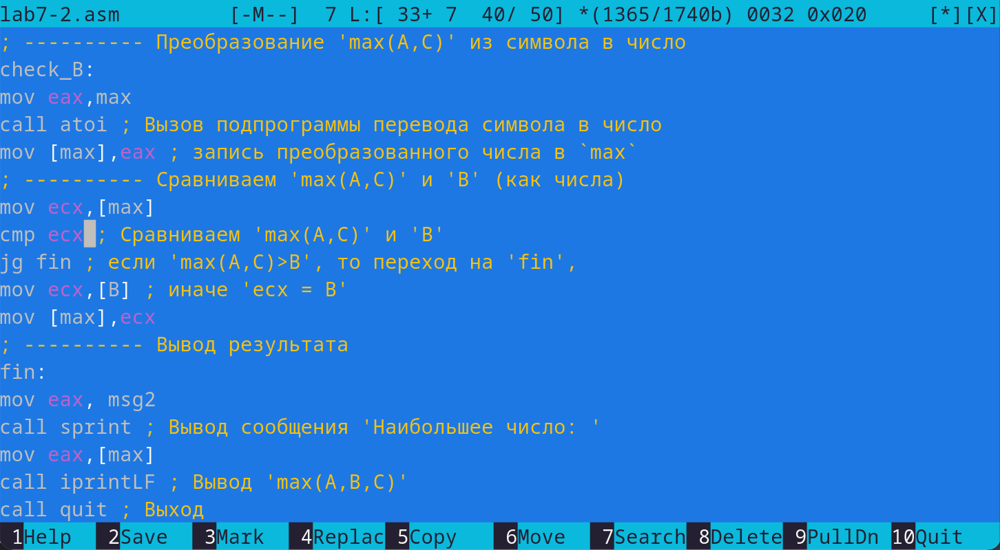{#fig-15 width=80%}

Пробую выполнить трансляцию с получением файла листинга. Сразу получаю ошибку об отсутствии операнда, тем не менее файл листинга создаётся (@fig-16).

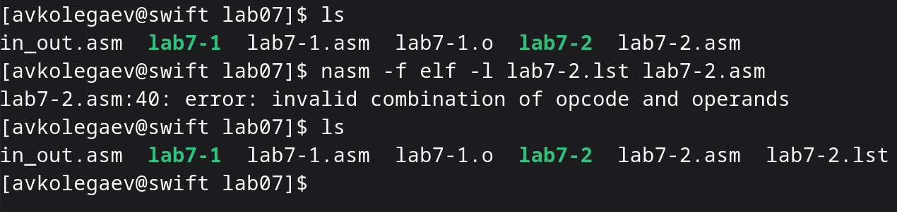{#fig-16 width=80%}

Вижу, что в файле листинга сразу после проблемной строчки ошибка тоже указана (@fig-17).

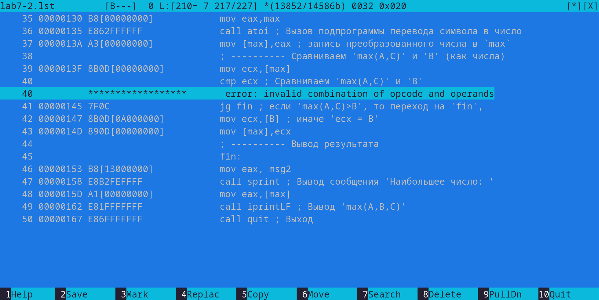{#fig-17 width=80%}

# Задание для самостоятельной работы

В новом файле `lab7-3.asm` пишу программу для нахождения наименьшей из трёх целочисленных переменных `a`, `b` и `c`. В моём случае их значения равны 79, 83 и 41 (вариант №6) (@fig-18).

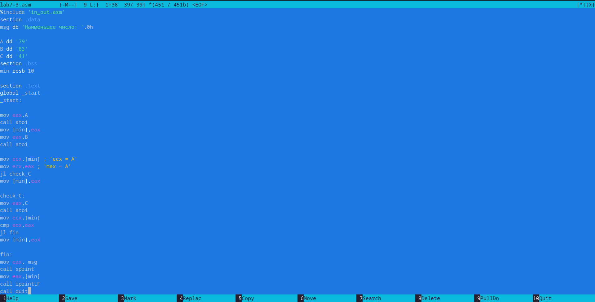{#fig-18 width=80%}

Компилирую и запускаю программу, получаю верный ответ (@fig-19).

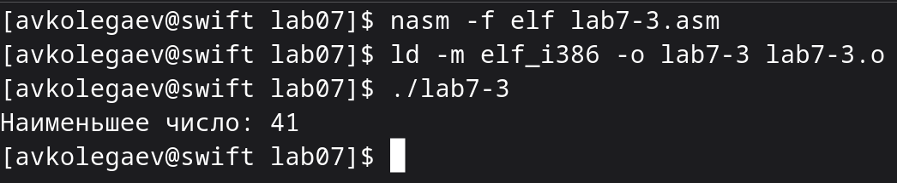{#fig-19 width=80%}

Теперь в файле `lab7-4.asm` пишу программу для вычисления значения функции, которая указана для 6 варианта (@fig-20) и (@fig-21).

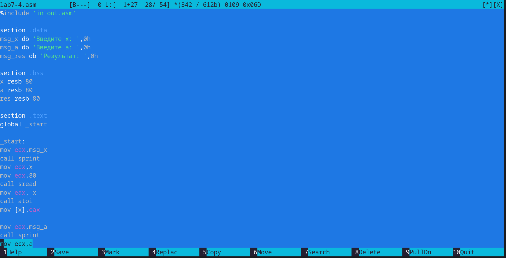{#fig-20 width=80%}

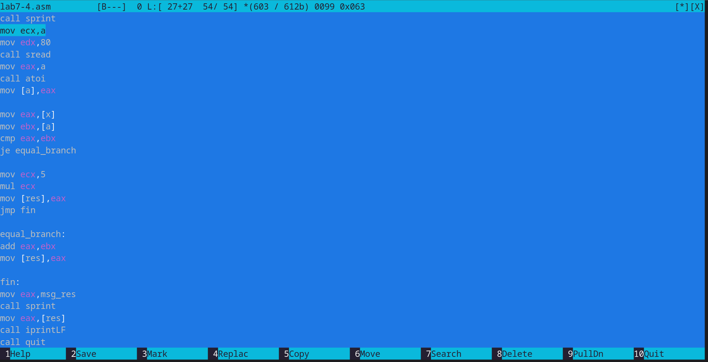{#fig-21 width=80%}

Запускаю программу при $x=2, a=2$ и при $x=2, a=1$, получаю верные результаты (@fig-22).

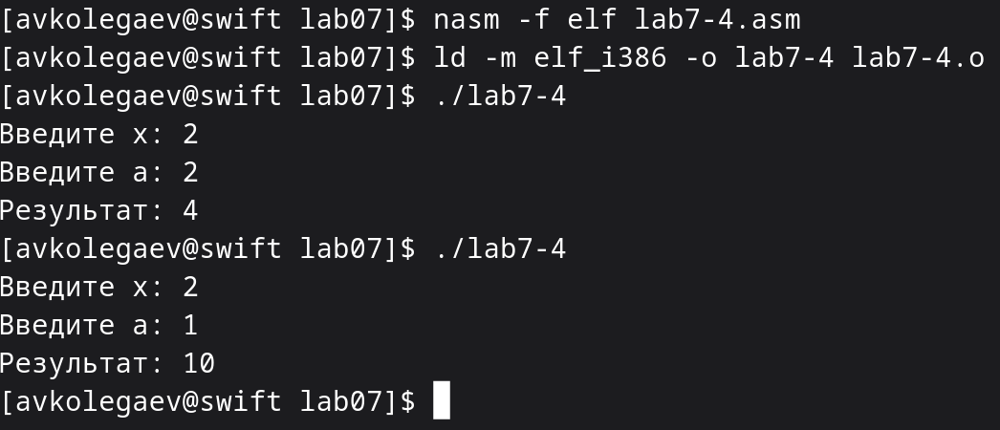{#fig-22 width=80%}

# Выводы

При выполнении данной лабораторной работы я приобрел навыки написания программ с использованием переходов и познакомился с назначением и структурой файла листинга.